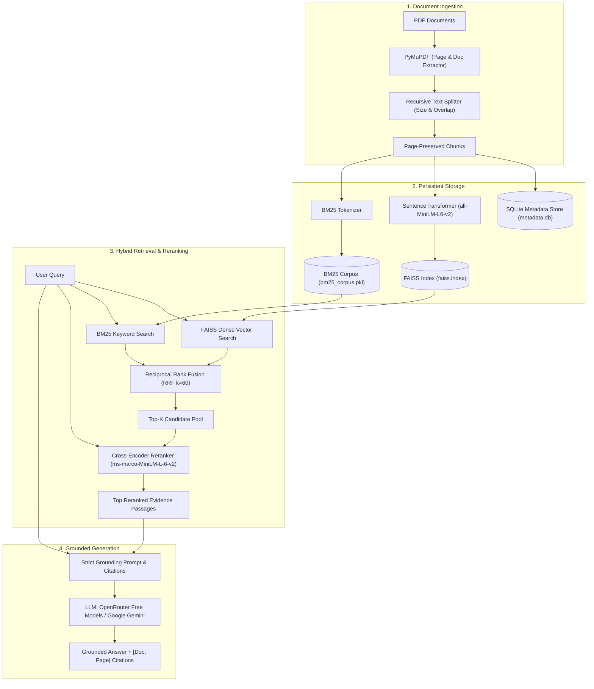

#  Hybrid RAG Search Engine with Reranking and Citations

A production-grade, locally runnable **Hybrid Retrieval-Augmented Generation (RAG) Search Engine** built with Python, FastAPI, Streamlit, FAISS, BM25, Cross-Encoder reranking, and the Google Gemini API.

Runs smoothly on Windows, Linux, and macOS using **CPU only** (no GPU required).

---

##  Key Features

1. **Multi-PDF Document Processing**: Ingest multiple PDF documents concurrently with PyMuPDF, preserving document names and exact 1-based page numbers.
2. **Context-Aware Semantic Chunking**: Configurable chunk size and overlap using recursive boundary preservation (paragraphs $\to$ sentences $\to$ words).
3. **Dense Semantic Search**: Vector embeddings generated via `sentence-transformers/all-MiniLM-L6-v2` and indexed with FAISS (`IndexFlatIP` with L2-normalized cosine similarity).
4. **Keyword Sparse Search**: Lexical BM25 index via `rank-bm25` for exact keyword and term matching.
5. **Reciprocal Rank Fusion (RRF)**: Combines dense vector rankings and sparse keyword rankings without score scaling discrepancies using standard $RRF(d) = \sum \frac{1}{k + r(d)}$.
6. **Cross-Encoder Reranking**: Reranks top candidates using `cross-encoder/ms-marco-MiniLM-L-6-v2`, performing full joint self-attention over `(query, passage)` pairs.
7. **Strict Grounding & Anti-Hallucination**: Answers are strictly constrained to retrieved context. Explicitly states when documents lack sufficient information instead of fabricating details.
8. **In-Text Page Citations**: Formats answers with clickable/bracketed references `[DocumentName.pdf, Page X]`.
9. **Full Index Persistence**: SQLite database stores chunk metadata, while FAISS vector index and BM25 tokenized corpus are serialized to disk to eliminate re-indexing across app restarts.
10. **Interactive Dual-Interface**: FastAPI backend with OpenAPI docs + modern Streamlit frontend with a Hybrid Search Inspector.

---

##  Architecture Diagram



---

##  Project Structure

```
HybridRAG/
├── backend/
│   ├── __init__.py
│   ├── config.py                 # Central configuration loaded from .env
│   ├── pipeline.py               # RAG pipeline orchestrator
│   ├── main.py                   # FastAPI application & REST endpoints
│   ├── ingestion/
│   │   ├── __init__.py
│   │   ├── pdf_extractor.py      # PyMuPDF page-by-page text extraction
│   │   └── text_splitter.py      # Semantic chunking preserving page metadata
│   ├── embeddings/
│   │   ├── __init__.py
│   │   └── embedder.py           # Sentence-Transformers embedding model
│   ├── storage/
│   │   ├── __init__.py
│   │   ├── faiss_index.py        # FAISS IndexIDMap persistent vector store
│   │   ├── metadata_store.py     # SQLite store for docs, chunks, and citations
│   │   └── bm25_store.py         # Serialized BM25 tokenized corpus
│   ├── retrieval/
│   │   ├── __init__.py
│   │   ├── vector_search.py      # Dense FAISS vector retriever
│   │   ├── keyword_search.py     # Sparse BM25 keyword retriever
│   │   ├── rrf.py                # Reciprocal Rank Fusion implementation
│   │   └── hybrid_search.py      # Hybrid retriever coordinator
│   ├── reranking/
│   │   ├── __init__.py
│   │   └── cross_encoder.py      # Cross-Encoder joint scoring
│   └── generation/
│       ├── __init__.py
│       ├── prompt_templates.py   # Grounding rules & citation formatting
│       └── generator.py          # Gemini API client with fallback & guardrails
├── frontend/
│   └── app.py                    # Streamlit interface (Chat, Upload, Inspector)
├── tests/
│   ├── __init__.py
│   ├── test_ingestion.py         # PDF extraction and chunking tests
│   ├── test_retrieval.py         # FAISS, BM25, and RRF unit tests
│   ├── test_reranking.py         # Cross-Encoder scoring test
│   ├── test_pipeline.py          # End-to-end pipeline test
│   └── test_api.py               # FastAPI endpoint tests
├── .env.example                  # Environment template
├── .gitignore                    # Git ignore file
├── requirements.txt              # Production dependencies
├── pytest.ini                    # Pytest configuration
└── README.md                     # Documentation
```

---

##  Key Design Decisions

### 1. Why Reciprocal Rank Fusion (RRF)?
Pure vector search often misses exact alphanumeric terms, acronyms, and product codes (e.g. `ISO-9001`, `Section 4.2.1`). Conversely, keyword search (BM25) fails on synonyms and paraphrased questions. 

Combining raw scores with linear weighting ($\alpha \cdot S_{vector} + (1-\alpha) \cdot S_{BM25}$) is fragile because BM25 scores are unbounded $[0, \infty)$ while cosine similarities are bounded $[-1, 1]$, requiring complex score calibration.

**RRF solves this** by operating strictly on ordinal rank positions:
$$RRF\_Score(d) = \sum_{m \in M} \frac{1}{k + r_m(d)}$$
where $k=60$ prevents top-ranked outliers from dominating. If a chunk appears in both the BM25 top-10 and Vector top-10, its reciprocal ranks compound, naturally elevating it.

### 2. Why Two-Stage Retrieval (Hybrid + Cross-Encoder)?
- **Stage 1 (Bi-Encoder + BM25)**: Evaluates query and passages independently. Very fast ($O(1)$ with index lookups), allowing broad search over thousands of chunks.
- **Stage 2 (Cross-Encoder)**: Evaluates the query and candidate passage simultaneously using full cross-attention across all token pairs. Significantly higher semantic precision, filtering out false positives before LLM generation.

### 3. Exact Page-Number Provenance
Instead of slicing documents into arbitrary character spans across page boundaries, our ingestion extracts text **page-by-page** and preserves the exact 1-based page number and document filename in SQLite. Every chunk retrieved carries an unambiguous source citation `[document_name.pdf, Page X]`.

---

##  Quickstart Guide

### 1. Clone & Set Up Virtual Environment

```bash
# Clone the repository
git clone <repo_url>
cd HybridRAG

# Create virtual environment
python -m venv .venv

# Activate virtual environment
# On Windows (PowerShell):
.\.venv\Scripts\Activate.ps1
# On Linux/macOS:
source .venv/bin/activate

# Install dependencies
pip install -r requirements.txt
```

### 2. Configure Environment Variables

Copy `.env.example` to `.env`:

```bash
cp .env.example .env
```

Edit `.env` and set your preferred provider. You can use OpenRouter's completely free models or Google Gemini:

```env
# Option A: OpenRouter (Free models, no card required: https://openrouter.ai/keys)
OPENROUTER_API_KEY=sk-or-v1-...
OPENROUTER_MODEL=openrouter/free
LLM_PROVIDER=openrouter

# Option B: Google Gemini API (Get from: https://aistudio.google.com/)
GEMINI_API_KEY=your_gemini_key_here
GEMINI_MODEL=gemini-3.8-flash
```

*(Note: The system features an automatic 429 rate-limit fallback router. If a specific free provider experiences peak load, the generator automatically switches to alternative free candidates like `openrouter/free` and `nvidia/nemotron-3.5-lightning:free`.)*

### 3. Run the Backend API

Start the FastAPI server:
```bash
python -m backend.main
```
The API will be live at `http://127.0.0.1:8000`. You can explore interactive Swagger documentation at `http://127.0.0.1:8000/docs`.

### 4. Run the Streamlit Frontend

In a separate terminal (with the venv activated):
```bash
streamlit run frontend/app.py
```
Open `http://localhost:8501` in your browser.

---

##  Using the Streamlit UI

- **Grounded Q&A Chat Tab**: Ask questions in natural language. Answers appear with inline citations like `[paper.pdf, Page 3]`, followed by an interactive expander to inspect the exact retrieved text passages and confidence scores.
- **Document Management Tab**: Upload one or multiple PDFs. The app extracts pages, creates semantic chunks, generates embeddings, and saves everything to disk. View active indexed documents and remove them whenever needed.
- **Hybrid Search Inspector Tab**: Enter any query to compare the vector search rank vs. BM25 rank vs. RRF score vs. Cross-Encoder rerank score for each retrieved candidate passage.
- **System Documentation Tab**: Full in-app reference including architecture diagram, quickstart workflow, complete parameter list, and verified OpenRouter free models.

---

##  REST API Reference

| Method | Endpoint | Description |
|---|---|---|
| `GET` | `/api/health` | Returns backend health, indexed document count, and model telemetry |
| `POST` | `/api/documents/upload` | Uploads and indexes one or multiple PDF documents |
| `GET` | `/api/documents` | Lists all indexed documents and statistics |
| `DELETE` | `/api/documents/{doc_name}` | Deletes a document and re-syncs FAISS & BM25 indexes |
| `POST` | `/api/search` | Retrieves and reranks passages (without LLM generation) |
| `POST` | `/api/query` | End-to-end RAG Q&A with Gemini and citations |
| `POST` | `/api/reset` | Resets all indexes and metadata |

---

##  Running Tests

The test suite covers PDF extraction, recursive chunking, FAISS index lifecycle, BM25 keyword matching, Reciprocal Rank Fusion, Cross-Encoder reranking, anti-hallucination guardrails, and FastAPI endpoints.

Run all tests:
```bash
pytest
```
Run with detailed test logs:
```bash
pytest -v -s
```
